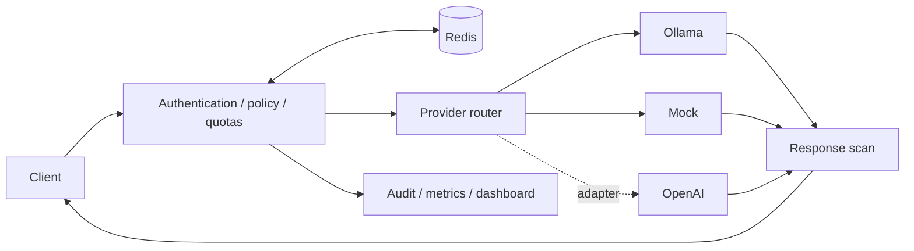

# Multi Provider LLM Security Gateway

A Python/FastAPI gateway that applies authentication, shared usage limits, and configurable security checks before forwarding chat requests to an LLM provider.

Run locally without paid API keys using the mock provider, or use Ollama for local inference. An OpenAI adapter is also included.

## Features

- API-key authentication and model permissions.
- Shared rate limits and token budgets using Redis.
- Configurable request/response filtering and PII redaction.
- Provider retries, fallback and circuit breakers.
- An operator dashboard, Prometheus metrics and content-free audit logs.
- Docker Compose and Kubernetes configuration.



## Try it

Requires Python 3.12+. From the repository root, in Windows PowerShell:

```powershell
python -m venv .venv
.\.venv\Scripts\python.exe -m pip install --constraint requirements.lock --upgrade pip
.\.venv\Scripts\python.exe -m pip install --constraint requirements.lock -e '.[dev]'
.\.venv\Scripts\python.exe scripts/smoke_demo.py
```

This starts temporary local servers and verifies JSON/SSE responses, email redaction, a blocked request, missing-key rejection and metrics. It then stops those servers. No Docker, Redis server or model download is required for this smoke test. [macOS/Linux setup](docs/reference.md#local-setup-python-312) · [Keep a live demo running](docs/demo.md)

## Dashboard

Follow the [local setup guide](docs/demo.md) to keep the app running. With Docker Compose, the operator console is at [localhost:8000/dashboard](http://localhost:8000/dashboard) and Grafana at [localhost:3000](http://localhost:3000).


[Dashboard preview](docs/assets/dashboard-preview.webm).

## Testing and limitations

GitHub Actions runs lint, type checks, tests, dependency checks, Docker builds and integration checks. See [CI runs](https://github.com/daygthb/Multi-Provider-LLM-Security-Gateway/actions) and the [verification notes](docs/verification.md) for recorded results.

Local Ollama JSON/SSE, Docker Compose and Docker Desktop Kubernetes have been exercised. Paid OpenAI calls and public production hosting have not. Pattern-based filters are not a guarantee against prompt injection. Responses are fully buffered and scanned before SSE delivery; this trades streaming latency for pre-delivery inspection. Short mock load checks do not establish production capacity.

## Documentation

- [Local setup and troubleshooting](docs/demo.md)
- [API, configuration, architecture and limitations](docs/reference.md)
- [Operations and recovery](docs/operations.md)
- [Production considerations](docs/production-readiness.md)
