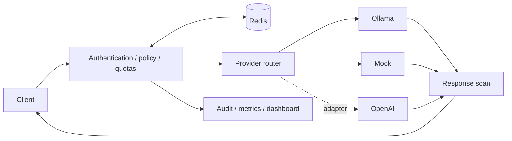
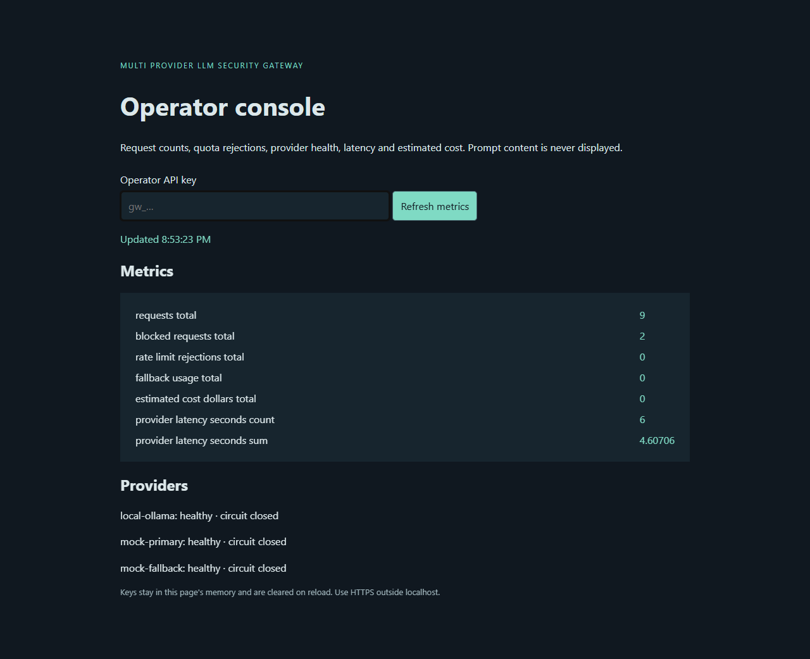

# Multi Provider LLM Security Gateway

A Python/FastAPI gateway that applies authentication, shared usage limits, and configurable security checks before forwarding chat requests to an LLM provider.

Built as a **SWE and AI-infrastructure portfolio project**. The local demo works without paid API keys. Real local inference is available through Ollama; the deterministic mock makes demonstrations repeatable.

## What it demonstrates

- **Backend engineering:** typed APIs, dependency injection, consistent errors, retries, fallback and circuit breakers.
- **Shared state:** Redis Lua scripts enforce atomic rate limits and tenant-wide token budgets.
- **Security tradeoffs:** hashed API keys, model permissions, PII redaction, configurable request/response rules and content-free audit logs.
- **Delivery:** Docker Compose, local Kubernetes manifests, Prometheus/Grafana and GitHub Actions.



## Try it

Requires Python 3.12+. From the repository root, in Windows PowerShell:

```powershell
python -m venv .venv
.\.venv\Scripts\python.exe -m pip install --constraint requirements.lock --upgrade pip
.\.venv\Scripts\python.exe -m pip install --constraint requirements.lock -e '.[dev]'
.\.venv\Scripts\python.exe scripts/smoke_demo.py
```

This starts temporary local servers and verifies JSON/SSE responses, email redaction, a blocked request, missing-key rejection and metrics. It then stops those servers. No Docker, Redis server or model download is required for this smoke test. macOS/Linux commands and a persistent live demo are in the [demo guide](docs/demo.md).

**Show it to someone:** follow the [two-minute walkthrough](docs/demo.md#two-minute-walkthrough). On the configured local Compose setup, the operator console is at [localhost:8000/dashboard](http://localhost:8000/dashboard) and Grafana at [localhost:3000](http://localhost:3000). These are local addresses, not public demo links.



[Silent dashboard preview](docs/assets/dashboard-preview.webm). This shows the real operator console, not the full API walkthrough or a public deployment.

## Verified, with limits

48 tests pass with **94.42% combined statement/branch coverage**. Hosted CI runs lint, typing, tests, dependency audit, image build, Compose smoke tests and isolated Redis recovery/restore checks. [CI runs](https://github.com/daygthb/Multi-Provider-LLM-Security-Gateway/actions) · [Detailed evidence](docs/verification.md)

Local Ollama JSON/SSE, Docker Compose and Docker Desktop Kubernetes have been exercised. Paid OpenAI calls and public production hosting have not. Pattern-based filters are not a guarantee against prompt injection. Responses are fully buffered and scanned before SSE delivery; this trades streaming latency for pre-delivery inspection. Short mock load checks do not establish production capacity.

## Explore

- [Demo and troubleshooting](docs/demo.md)
- [Résumé bullets and interview preparation](docs/career.md)
- [API, configuration, architecture and limitations](docs/reference.md)
- [Recovery procedures](docs/operations.md) · [Production-only release gates](docs/production-readiness.md)

This project demonstrates inference integration and backend reliability, not model training or fine-tuning. For an interview, focus on what you understand, tested and can change; describe any AI assistance honestly.
